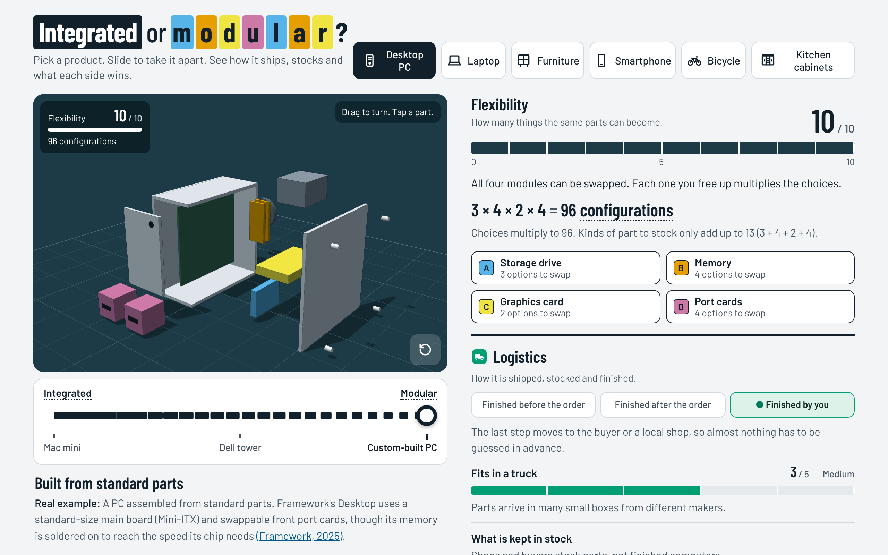

# Integrated or modular? A 3D supply chain trade-off slider

**Live link:** https://markfourman.github.io/design-modularity-slider/

Pick a product, then drag one slider from integrated (one sealed design) to modular (standard, swappable parts). A 3D model of the product comes apart as you go, and the flexibility, cost and benefit scores update live. It covers six products: a desktop PC, a laptop, furniture, a smartphone, a bicycle and kitchen cabinets. Each one has three real examples on the slider, with sources.

## What the slider teaches

The more modular a product is, the more flexible it is, for the customer and for the company. That flexibility has a price.

- **Choices multiply. Parts only add.** Four modules with 4, 3, 2 and 4 options make 4 × 3 × 2 × 4 = 96 products from 4 + 3 + 2 + 4 = 13 kinds of part. A modular maker can offer a lot of variety without stocking a lot of different finished products.
- **Shared parts lower inventory risk.** One stock of common parts can be turned into whichever product is ordered. This is called risk pooling.
- **Final assembly can wait.** If the product is finished only after the real order arrives, less has to be guessed in advance. This is called postponement.
- **Modular design changes the logistics.** A live Logistics panel shows when each product is finished (before the order, after the order, or by you), how well it fits in a truck, and what is kept in stock. Flat-pack furniture fills a truck; a finished sofa mostly ships air.
- **The logistics lesson.** Four cards from the SCM940 slides: HP's DeskJet postponement case (safety stock 3.8 to 2.6 weeks at a 98% service level, about $800,000 a year), design for logistics, making parts ahead and building on order, and tariffs on half-finished goods (Simchi-Levi et al., 2022).
- **Sealed designs win something too.** A single fixed design can be slimmer, better sealed against water and dust, and tighter fitting. Brand-only parts can also keep repair and upgrade sales with the maker. The app scores this as "Sleek and sealed", so each end of the slider wins something.
- **It is a trade-off, not a verdict.** Modular designs take more design work and more parts to manage. Unit cost can go either way: sealing parts in is the cheap end for electronics, and flat-pack is the cheap end for furniture.

## How to use it

1. Pick a product with the buttons at the top.
2. Drag the slider from Integrated to Modular, or tap one of the three names under it to jump to a real example.
3. Read the scores as they change. Drag the 3D model to turn it, and tap a part to see what it is.

Other things you can do:

- **Save this view** downloads a 1200 × 630 picture of the model and scores, sized for a LinkedIn post.
- Tap any word with a dotted underline for a plain definition.

## Compatibility

- One file, no build step, no typing anywhere. Works with touch, mouse and keyboard (arrow keys move the slider).
- The 3D view uses Three.js (r128) loaded from a CDN, with WebGL.
- If WebGL is switched off or the CDN is blocked, as on some work laptops, the page switches to a built-in basic 3D view. Everything else works the same, and the page shows a small "Basic 3D mode" note.
- Fonts (Barlow) come from Google Fonts. If they are blocked, the page falls back to system fonts.

## Files

| File | What it is |
| --- | --- |
| `index.html` | The whole app: HTML, CSS and JavaScript in one file |
| `preview.png` | The picture that shows when the link is shared (1200 × 630) |
| `screenshot.png` | The screenshot used in this README |
| `linkedin-post.md` | A launch post draft, plus a three-sentence version |

## Publishing on GitHub Pages

1. Create a public repository named `design-modularity-slider`.
2. Upload `index.html`, `preview.png`, `screenshot.png` and `README.md` to the main branch.
3. In the repository, open Settings, then Pages. Under "Build and deployment", choose "Deploy from a branch", pick `main` and `/ (root)`, and save.

The page goes live at the link above after a minute or two. The link preview and the "Copy LinkedIn post" button both use that address, so keep the repository name as it is.

## Which figures are illustrative and which are sourced

**Illustrative (judgments made for teaching, not measurements):**

- Every score: flexibility out of 10, and the three cost scores and four benefit scores out of 5. Each has its reason printed beside it.
- The number of options per module (for example 3, 4, 2 and 4) and the totals that follow from them (96 configurations, 13 kinds of part). The totals are plain arithmetic on the example numbers.
- Scores between two anchors. They are blended in a straight line from the two nearest anchors.
- The 3D models. They are simple teaching models, not drawings of real products.

**Sourced (each has a citation in the app and in the references below):**

Every real example on the slider (for instance Mac mini, MacBook Air, Lenovo ThinkPad, Framework, La-Z-Boy, IKEA, iPhone, Galaxy A17, Fairphone, Raleigh at Canadian Tire, Giant, Specialized, KraftMaid) has a citation beside it in the app, and the full list is in the references below. "The Brick / Leon's" and "Custom-built PC" are general categories with no specific cited fact. The 4 × 3 × 2 × 4 = 96 example comes from the SCM940 Chapter 10 slides (Dell desktop).

No market prices are used anywhere in the app.

All web sources were retrieved on November 14, 2026.

## References

- Apple. (2026a, September 21). *Upgrade or install memory in your Mac mini*. Apple Support. Retrieved November 14, 2026, from <https://support.apple.com/en-ca/102328>
- Apple. (2026b, October 23). *iPhone introduction* [Repair manual]. Apple Support. Retrieved November 14, 2026, from <https://support.apple.com/en-ca/125146>
- Canadian Tire. (n.d.). *Raleigh Sprint road bike* [Product page, questions and answers]. Retrieved November 14, 2026, from <https://www.canadiantire.ca/en/pdp/p-0711952p.html>
- Dell. (2026, October 9). *Upgrades to consider for your Dell computer* (Article No. 000191108). Dell Support. Retrieved November 14, 2026, from <https://www.dell.com/support/kbdoc/en-ca/000191108/upgrades-to-consider-for-your-dell-computer>
- EveryMac. (n.d.). *Apple MacBook Air "M4" 10 CPU/10 GPU 13" specs*. Retrieved November 14, 2026, from <https://everymac.com/systems/apple/macbook-air/specs/macbook-air-m4-10-core-cpu-10-core-gpu-13-2025-specs.html>
- Fairphone. (n.d.). *The Fairphone (Gen. 6)*. Retrieved November 14, 2026, from <https://www.fairphone.com/the-fairphone-gen-6>
- Feitzinger, E., & Lee, H. L. (1997). Mass customization at Hewlett-Packard: The power of postponement. *Harvard Business Review, 75*(1), 116–121.
- Fisher, M. L. (1997). What is the right supply chain for your product? *Harvard Business Review, 75*(2), 105–116.
- Framework. (2025, February 25). *Introducing the Framework Desktop* [Online forum post]. Framework Community. Retrieved November 14, 2026, from <https://community.frame.work/t/introducing-the-framework-desktop/65008>
- Framework. (n.d.). *Framework Laptop 13*. Retrieved November 14, 2026, from <https://frame.work/laptop13>
- Giant Bicycles. (n.d.). *D-Fuse composite seatpost*. Retrieved November 14, 2026, from <https://www.giant-bicycles.com/au/d-fuse-composite-seatpost>
- The Home Depot Canada. (n.d.). *How to buy kitchen cabinets: Buying guide*. Retrieved November 14, 2026, from <https://www.homedepot.ca/en/home/ideas-how-to/kitchen/how-to-buy-kitchen-cabinets.html>
- IKEA Canada. (n.d.). *How to choose kitchen cabinets and cabinet interiors*. Retrieved November 14, 2026, from <https://www.ikea.com/ca/en/rooms/kitchen/how-to/how-to-choose-kitchen-cabinets-and-cabinet-interiors-pubde8f91e0>
- IKEA Museum. (n.d.). *How IKEA took flatpacks to a whole new level*. Retrieved November 14, 2026, from <https://ikeamuseum.com/en/explore/the-story-of-ikea/flatpacks/>
- KraftMaid. (2022, June 23). *What are standard kitchen cabinet sizes?* Retrieved November 14, 2026, from <https://www.kraftmaid.com/kraftmaid/kitchen-cabinet-sizes>
- La-Z-Boy Ottawa & Kingston. (n.d.). *Custom furniture at La-Z-Boy: What to expect*. Retrieved November 14, 2026, from <https://stylemeetscomfort.ca/blog/custom-furniture-at-la-z-boy-what-to-expect/>
- Lenovo. (n.d.). *ThinkPad P1 Gen 8 and ThinkPad T1g Gen 8 user guide: CRU list*. Retrieved November 14, 2026, from <https://download.lenovo.com/manual/thinkpad_p1_gen8_t1g_gen8/user_guide/en/CRU_list.html>
- Samsung Canada. (2026, January 15). *Samsung Canada introduces the Galaxy A17 5G with everyday AI and essential performance*. Samsung Newsroom Canada. Retrieved November 14, 2026, from <https://news.samsung.com/ca/samsung-canada-introduces-the-galaxy-a17-5g-with-everyday-ai-and-essential-performance>
- Simchi-Levi, D., Kaminsky, P., & Simchi-Levi, E. (2022). *Designing and managing the supply chain: Concepts, strategies and case studies* (4th ed.). McGraw Hill.
- Specialized. (n.d.). *S-Works Epic 29er frameset*. Retrieved November 14, 2026, from <https://specialized.com/us/en/s-works-epic-29er-frameset/p/23663>
- Ulrich, K. (1995). The role of product architecture in the manufacturing firm. *Research Policy, 24*(3), 419–440.

## Credits

Built by [Mark Fourmanovskis](https://www.linkedin.com/in/mark-fourmanovskis/), a supply chain management student at Seneca Polytechnic. 3D drawing uses [Three.js](https://threejs.org/) (MIT licence).
